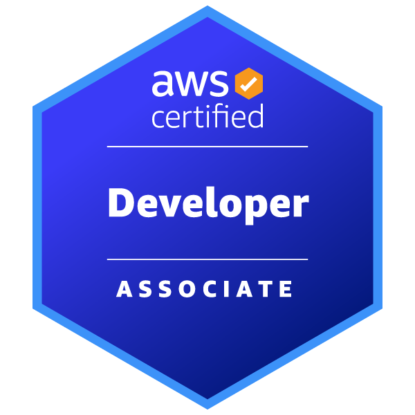

# Developer (DVA-C02)

Estado do material: **em revisao**. Origem: anotações anteriores migradas; conferência online das fontes pendente (rede bloqueada).

    

---

## 1. Introdução

A certificação **AWS Certified Developer – Associate (DVA-C02)** é voltada para desenvolvedores que desejam validar suas habilidades na criação, implantação e manutenção de aplicações baseadas em nuvem usando a AWS. Ela comprova o conhecimento prático em serviços essenciais como AWS Lambda, Amazon API Gateway, Amazon DynamoDB, S3, entre outros, bem como no uso de SDKs da AWS, integração de APIs e boas práticas de segurança. É ideal para profissionais que já possuem experiência no desenvolvimento de software e desejam aprofundar sua proficiência em criar soluções otimizadas, escaláveis e seguras na nuvem AWS.

---

## 2. Escopo e Fundamentos da Certificação

A certificação **AWS Certified Developer – Associate (DVA-C02)** avalia a capacidade do profissional de **desenvolver, implantar e depurar aplicações na AWS**, abrangendo conceitos essenciais como:

* **Fundamentos da Nuvem AWS**
  Compreensão de regiões, zonas de disponibilidade, VPCs e como os serviços da AWS se conectam.

* **Serviços Essenciais para Desenvolvimento**
  Uso de serviços como **AWS Lambda, Amazon API Gateway, Amazon DynamoDB, Amazon S3, Amazon SNS/SQS** e **AWS Step Functions** para criar aplicações serverless e baseadas em eventos.

* **Integração e SDKs**
  Conhecimento em **AWS CLI, AWS SDKs** e ferramentas para automação de tarefas, chamadas de APIs e integração de código.

* **Boas Práticas de Segurança**
  Aplicação de **IAM (Identity and Access Management)**, roles, políticas, controle de permissões e gerenciamento seguro de credenciais e segredos.

* **Monitoramento e Depuração**
  Uso de **Amazon CloudWatch**, **AWS X-Ray** e logs para inspecionar, monitorar e corrigir problemas em aplicações.

---

## 3. Principais Serviços AWS para DVA-C02

A certificação exige conhecer vários serviços, mas alguns são críticos e aparecem em múltiplas questões. Aqui está um guia conceitual que mostra como eles se conectam e quando usá-los.

---

### 3.1 Cálculo e Execução de Código

* **AWS Lambda** → Funções serverless, triggers, limites de execução, layers e variáveis de ambiente.
* **Amazon ECS / AWS Fargate** → Execução de containers com ou sem gerenciamento de servidores.
* **AWS Elastic Beanstalk** → Deploy rápido de aplicações sem precisar orquestrar a infraestrutura.

---

### 3.2 Armazenamento e Banco de Dados

* **Amazon S3** → Buckets, políticas, versionamento, eventos e segurança de objetos.
* **Amazon DynamoDB** → NoSQL gerenciado, chaves primárias, índices secundários, throughput provisionado/on-demand, TTL.
* **Amazon RDS / Aurora** → Bancos relacionais gerenciados, replicação, failover e otimização.

---

### 3.3 Integração e Comunicação

* **Amazon API Gateway** → Criação e segurança de APIs REST/HTTP/WebSocket, integrações com Lambda e autenticação.
* **Amazon SNS / SQS** → Comunicação assíncrona com tópicos (pub/sub) e filas (mensageria).
* **AWS Step Functions** → Orquestração de workflows serverless com controle de estados.
* **Amazon EventBridge** → Roteamento de eventos entre serviços e sistemas externos.

---

### 3.4 Segurança

* **AWS IAM** → Usuários, grupos, roles, políticas e credenciais temporárias.
* **AWS KMS** → Gestão de chaves; CMK é terminologia antiga para chaves gerenciadas pelo cliente.
* **AWS Secrets Manager / SSM Parameter Store** → Armazenamento seguro de senhas e configurações.
* **Amazon Cognito** → Autenticação e autorização de usuários para aplicações web e mobile.

---

### 3.5 Monitoramento e Depuração

* **Amazon CloudWatch** → Logs, métricas, alarmes e dashboards personalizados.
* **AWS X-Ray** → Rastreamento e diagnóstico de requisições.

---

## 4. Estratégias de Estudo e Preparação para o DVA-C02

### 4.1 Formato citado na origem — conferir guia vigente

* **Número de questões**: 65 perguntas de múltipla escolha e múltipla resposta.
* **Tempo**: 130 minutos.
* **Pontuação mínima para aprovação**: \~720/1000.
* **Formato**: Situações reais (cenários) que exigem identificar o serviço mais adequado ou a solução correta.

---

### **4.2 Roteiro de Estudo Sugerido**

1. **Fundamentos** – Revise conceitos essenciais de nuvem e arquitetura AWS (regiões, AZs, VPC, IAM).
2. **Serviços-chave** – Aprofunde-se nos serviços listados no ponto 3, especialmente Lambda, API Gateway, S3, DynamoDB e SQS/SNS.
3. **Hands-on** – Planeje aplicações serverless/eventos com autorização, estimativa de custos e limpeza; Free Tier depende da oferta e da conta.
4. **Prática com CLI e SDKs** – Automatize tarefas simples e integre aplicações com serviços AWS via SDK.
5. **Segurança** – Estude IAM, roles, políticas e práticas seguras de acesso.
6. **Monitoração e Troubleshooting** – Pratique com CloudWatch e X-Ray para identificar gargalos.

---

## Referências principais e limites

O inventário específico e a estratégia de preparação acima foram preservados. Os dados de formato (65 questões, 130 minutos, pontuação e idiomas) são os da origem, **não confirmados como vigentes**. Confira o guia no índice da trilha. Frequência de assuntos e “dicas de prova” não substituem os requisitos do enunciado nem comprovam pesos oficiais.

Não há laboratório executado, resultado de simulado ou domínio pessoal registrado. Prefira justificar decisões e trade-offs em vez de aplicar regras como “gerenciado sempre é correto”.

* [Fundamentos](../../fundamentos/README.md)
* [Serviços: explicações principais](../../servicos/README.md)
* [Revisão e sessão ativa](revisao.md)
* [Registrar erros](erros.md)
* [Perguntas próprias](../perguntas-fundamentais.md)

[Voltar ao índice](README.md)
