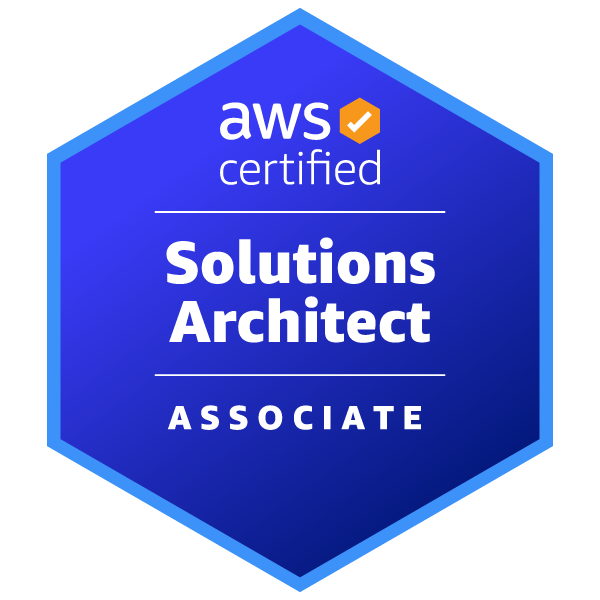

# Solutions Architect (SAA-C03)

Estado do material: **em revisao**. Origem: anotações anteriores migradas; conferência online das fontes pendente (rede bloqueada).

    

---

## 1. Introdução

A certificação **AWS Certified Solutions Architect – Associate (SAA-C03)** é destinada a profissionais que desejam validar suas habilidades em projetar soluções distribuídas e escaláveis na AWS. Ela comprova o conhecimento em **arquitetar sistemas seguros, de alta disponibilidade, tolerantes a falhas e com custo otimizado**, usando os serviços e melhores práticas recomendados pela AWS.
O foco do exame está em **analisar requisitos**, **selecionar os serviços adequados** e **projetar arquiteturas que atendam às necessidades de negócios**, equilibrando desempenho, segurança e custo.

Essa certificação é ideal para profissionais que atuam como **arquitetos de soluções**, **engenheiros de nuvem** ou desenvolvedores experientes que querem ampliar suas competências em design de arquiteturas AWS.

---

## 2. Escopo e Fundamentos da Certificação

A **AWS Certified Solutions Architect – Associate (SAA-C03)** avalia a capacidade de projetar soluções robustas na AWS, abrangendo:

* **Princípios de Arquitetura AWS**
  * Alta disponibilidade, escalabilidade, elasticidade e tolerância a falhas.
  * Escolha de regiões e zonas de disponibilidade.
  * Arquiteturas multi-tier e desacoplamento de componentes.

* **Serviços Essenciais**
  * **Computação**: EC2, Lambda, ECS/Fargate, Elastic Beanstalk.
  * **Armazenamento**: S3, EBS, EFS, FSx.
  * **Bancos de dados**: RDS, DynamoDB, Aurora, ElastiCache.
  * **Rede**: VPC, subnets, Route 53, ELB, CloudFront.

* **Segurança**
  * IAM (usuários, roles, políticas).
  * Criptografia (KMS, ACM).
  * Segurança de rede (Security Groups, NACLs).

* **Otimização de Custos**
  * Escolha adequada de tipos de instância.
  * Armazenamento de baixo custo.
  * Uso eficiente de serviços gerenciados.

* **Monitoramento e Operações**
  * CloudWatch, CloudTrail, AWS Config.
  * Estratégias de backup e recuperação.

---

## 3. Principais Serviços AWS para SAA-C03

A prova do SAA-C03 é bem distribuída entre várias áreas, mas alguns serviços e conceitos aparecem com frequência muito alta e são cruciais para resolver cenários do exame.

---

### 3.1 Computação

* **Amazon EC2** → Tipos de instância, auto scaling, placement groups, spot e reserved instances.
* **AWS Lambda** → Execução serverless, integrações com eventos, limites e camadas.
* **Amazon ECS / Fargate** → Containers com e sem gerenciamento de servidores.
* **AWS Elastic Beanstalk** → Deploy e gestão de ambiente simplificados; configuração e responsabilidades continuam com o cliente.

---

### 3.2 Armazenamento

* **Amazon S3** → Classes de armazenamento, políticas, versionamento, replicação e eventos.
* **Amazon EBS** → Tipos de volumes, snapshots e performance.
* **Amazon EFS** → Sistema de arquivos elástico e compartilhado.
* **Amazon FSx** → Sistemas de arquivos especializados (Windows, Lustre).

---

### 3.3 Bancos de Dados

* **Amazon RDS / Aurora** → Bancos relacionais gerenciados, replicação e failover.
* **Amazon DynamoDB** → NoSQL gerenciado, índices, throughput e TTL.
* **Amazon ElastiCache** → Redis e Memcached para cache de baixa latência.

---

### 3.4 Rede e Entrega de Conteúdo

* **Amazon VPC** → Subnets públicas/privadas, peering, endpoints, NAT Gateway.
* **Elastic Load Balancing (ELB)** → ALB, NLB e GLB.
* **Amazon Route 53** → DNS, roteamento geográfico e failover.
* **Amazon CloudFront** → CDN, distribuição global e integração com S3.

---

### 3.5 Segurança e Identidade

* **AWS IAM** → Políticas, roles, grupos e melhores práticas de acesso.
* **AWS KMS** → Criptografia e gerenciamento de chaves.
* **AWS ACM** → Certificados SSL/TLS gerenciados.
* **Security Groups / NACLs** → Controle de tráfego em nível de instância e subnet.

---

### 3.6 Monitoramento e Operações

* **Amazon CloudWatch** → Logs, métricas, alarmes e dashboards.
* **AWS CloudTrail** → Auditoria de chamadas de API.
* **AWS Config** → Conformidade e histórico de configurações.

---

## 4. Estratégias de Estudo e Preparação para o SAA-C03

### 4.1 Formato citado na origem — conferir guia vigente

* **Número de questões**: 65 perguntas de múltipla escolha ou múltipla resposta.
* **Tempo**: 130 minutos.
* **Pontuação mínima para aprovação**: ~720/1000.
* **Formato**: Cenários reais que exigem análise de requisitos e escolha da arquitetura mais adequada.
* **Idioma**: Disponível em português e inglês (vale treinar os termos técnicos em inglês).

---

### 4.2 Roteiro de Estudo Sugerido

1. **Fundamentos de Arquitetura** – Estude os pilares do *AWS Well-Architected Framework* (Excelência Operacional, Segurança, Confiabilidade, Eficiência de Performance, Otimização de Custos e Sustentabilidade).
2. **Serviços Críticos** – Domine os tópicos do item 3, especialmente EC2, S3, RDS, VPC, CloudFront e Route 53.
3. **Design para Alta Disponibilidade** – Pratique arquiteturas multi-AZ, multi-região, failover e escalabilidade automática.
4. **Segurança e Identidade** – Entenda IAM, Security Groups, NACLs, KMS e práticas de criptografia ponta a ponta.
5. **Networking** – Treine cenários com VPC, subnets, NAT, endpoints e balanceadores.
6. **Otimização de Custos** – Saiba escolher instâncias, classes de armazenamento e estratégias de *lifecycle* no S3.
7. **Hands-on** – Planeje exercícios com orçamento, autorização e limpeza; confira oferta/eligibilidade de Free Tier e não presuma custo zero.
8. **Simulados** – Resolva *practice exams* e analise o *feedback* para reforçar pontos fracos.

---

### 4.3 Dicas de Ouro

* **Leia o enunciado até o fim** — a AWS gosta de inserir pegadinhas com requisitos implícitos.
* **Priorize soluções gerenciadas** — na maioria dos cenários, a opção mais escalável e resiliente é a correta.
* **Cuidado com custos** — se o enunciado citar “otimizar custos”, avalie *Reserved Instances*, *Spot Instances* e S3 IA/Glacier.
* **Pense em segurança por padrão** — se o requisito envolver dados sensíveis, aplique criptografia e restrinja acessos.
* **Decore limites importantes** — por exemplo, tempo de execução do Lambda, limites de VPC e instâncias suportadas por tipo.

## Referências principais e limites

O inventário específico e a estratégia de preparação acima foram preservados. Os dados de formato (65 questões, 130 minutos, pontuação e idiomas) são os da origem, **não confirmados como vigentes**. Confira o guia no índice da trilha. Frequência de assuntos e “dicas de prova” não substituem os requisitos do enunciado nem comprovam pesos oficiais.

Não há laboratório executado, resultado de simulado ou domínio pessoal registrado. Prefira justificar decisões e trade-offs em vez de aplicar regras como “gerenciado sempre é correto”.

* [Fundamentos](../../fundamentos/README.md)
* [Serviços: explicações principais](../../servicos/README.md)
* [Revisão e sessão ativa](revisao.md)
* [Registrar erros](erros.md)
* [Perguntas próprias](../perguntas-fundamentais.md)

[Voltar ao índice](README.md)
