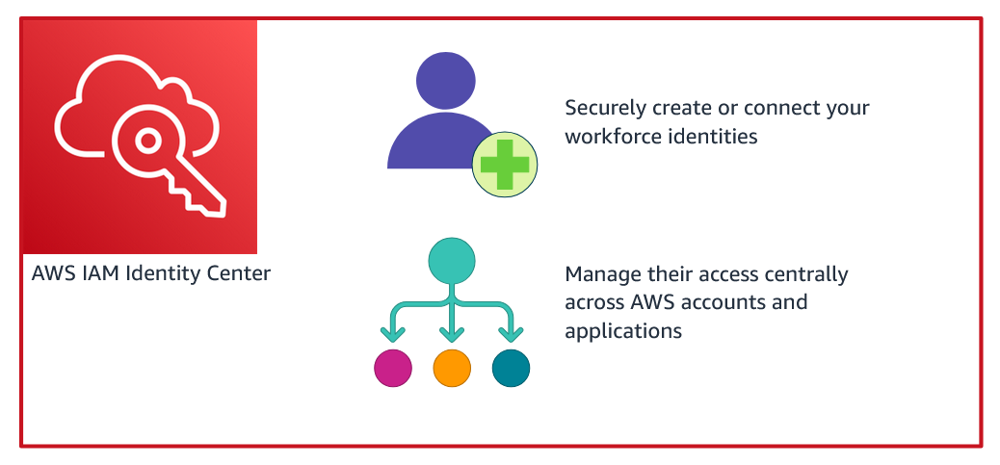

# AWS Educate — Security

Estado do material: **rascunho**. Origem: AWS Educate, Security incompleto.
Revisão técnica nas fontes: pendente; acesso oficial bloqueado em 2026-10-30.

## Escopo do rascunho

As notas originais continham títulos e imagens, sem explicações completas. Foram retiradas a imagem sem endereço e a imagem de custos com legenda incorreta de pilares. Este resumo **não está concluído**; retomar as quatro seções do módulo em uma sessão real.

## Seção 1 — Introdução à segurança

Comece pelo [modelo de responsabilidade compartilhada](../../fundamentos/responsabilidade-compartilhada.md). Complete depois exemplos de responsabilidade do cliente em EC2 e em serviços gerenciados, relacionando confidencialidade, integridade e disponibilidade.

## Seção 2 — Introdução a IAM

Use [IAM](../../servicos/seguranca-identidade/iam.md) para usuários, grupos, funções, políticas e MFA. O trecho sobre MFA e custos era apenas um título; a explicação principal agora existe na referência, sem presumir que o usuário a estudou.

[Identity Center](../../servicos/seguranca-identidade/identity-center.md) organiza o acesso da força de trabalho; não gerencia principalmente access keys IAM. Falta completar as observações da aula sobre identidades e práticas de acesso.

## Seção 3 — Uso de IAM e suporte

As interfaces registradas no curso são Console, CLI e SDK, sujeitas a permissões e autenticação. Planos de suporte e sua oferta vigente exigem consulta atual; a imagem histórica permanece no [acervo de operações](../../assets/aws-educate/cloud-operations/README.md), sem comprovar disponibilidade comercial atual.

## Seção 4 — Serviços adicionais

A origem citava CloudWatch com uma imagem. Falta distinguir monitoramento (CloudWatch), auditoria de APIs (CloudTrail), configuração (Config) e agregação de achados ([Security Hub](../../servicos/seguranca-identidade/security-hub.md)).

## Próxima ação e fonte

Reabrir o módulo, preencher as lacunas com exemplos próprios e fontes, revisar tecnicamente e só então alterar o estado deste material. A pendência também está no [roadmap](../../ROADMAP.md#backlog).

- [AWS Educate](https://aws.amazon.com/education/awseducate/)

[Voltar ao índice](README.md)
