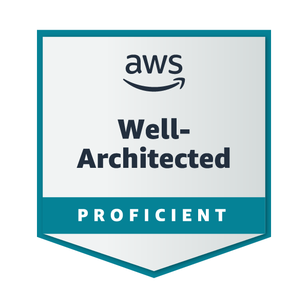

# AWS Well-Architected Framework

Estado do material: **em revisao**. Origem: anotações anteriores migradas; conferência online das fontes pendente (rede bloqueada).

<div align="center">
    
</div>

---

## O que é?

O **AWS Well-Architected Framework (WA)** é o conjunto de **melhores práticas** para desenhar workloads **seguros, confiáveis, performáticos, econômicos e sustentáveis** na AWS.
Ele traz **perguntas, princípios e controles** que ajudam você a **avaliar** e **melhorar** sua arquitetura continuamente.

---

Governança continua relevante como gestão de políticas, conformidade, auditoria e controles; **não é um sétimo pilar**. A nota principal consolida seis pilares. A imagem de badge é referência do acervo, sem comprovar conclusão de curso.

## Por que usar (na prática)

- **Evitar tombos caros**: encontra riscos (HRIs/MRIs) **antes** de virarem incidente.
- **Foco no que importa**: decisões com base em **pilares** e **trade-offs** explícitos.
- **Base de estudo**: conecte princípios aos objetivos do guia da certificação escolhida, sem presumir cobertura integral.
- **Cultura de melhoria**: revisão periódica, plano de ação e métricas.

---

## Os seis pilares

Os tópicos seguintes mantêm princípios, práticas e exemplos do curso, organizados pelos seis pilares. Não são transcrição integral dos princípios oficiais vigentes; confira a fonte ao revisar tecnicamente.

## Excelência operacional (Operational Excellence)

### Princípios Essenciais

- **Operações como código**: Infraestrutura e processos definidos e gerenciados através de código
- **Mudanças pequenas e reversíveis**: Implementar alterações graduais com capacidade de rollback
- **Refinamento contínuo**: Evolução constante de procedimentos operacionais
- **Antecipação de falhas**: Realização de pre-mortems e game days proativos
- **Aprendizado contínuo**: Análise sistemática de todas as falhas operacionais

### Práticas-Chave

- **IaC (Infrastructure as Code)**: AWS CloudFormation, Terraform
- **CI/CD**: AWS CodePipeline, CodeBuild, CodeDeploy
- **Observabilidade**: Amazon CloudWatch, AWS X-Ray, Dashboards
- **Runbooks/Playbooks**: Documentação operacional automatizada
- **Game Days**: Simulações regulares de falhas

### Serviços AWS Principais

```plaintext
CloudFormation, CodeSuite, CloudWatch, Systems Manager, X-Ray
```

## Segurança (Security)

### Princípios Fundamentais

- **Base sólida de identidade**: IAM forte com princípio do menor privilégio
- **Rastreabilidade completa**: Logging, monitoring e auditoria integrados
- **Defesa em profundidade**: Múltiplas camadas de segurança
- **Automatização de segurança**: Controles definidos como código
- **Proteção de dados**: Criptografia em trânsito e repouso
- **Separação de acesso**: Minimizar acesso humano direto a dados
- **Preparação para incidentes**: Planos de resposta testados

### Implementações Críticas

- **IAM**: MFA, políticas baseadas em tags, roles temporárias
- **Monitoring**: AWS CloudTrail, GuardDuty, Security Hub
- **Proteção de Dados**: AWS KMS, CloudHSM, Certificate Manager
- **Network Security**: Security Groups, NACLs, AWS WAF, Shield
- **Compliance**: AWS Config, Audit Manager, Artifact

### Serviços AWS Essenciais

```plaintext
IAM, KMS, CloudTrail, GuardDuty, WAF, Shield, Security Hub, Config
```

## Confiabilidade (Reliability)

### Princípios Centrais

- **Recuperação automática**: Auto-healing baseado em monitoring
- **Testes de recuperação**: Validação regular de procedures de DR
- **Escalabilidade horizontal**: Arquiteturas distribuídas e resilientes
- **Gestão de capacidade**: Monitoramento contínuo de demanda
- **Gestão de mudanças**: Automação de deployments e rollbacks

### Estratégias de Implementação

- **Multi-AZ/Multi-Region**: Distribuição geográfica de cargas
- **Auto Scaling**: Ajuste dinâmico de capacidade
- **Load Balancing**: Distribuição inteligente de tráfego
- **Backup/DR**: Estratégias baseadas em RTO/RPO
- **Circuit Breakers**: Padrões de resiliência em aplicações

### Serviços AWS Chave

```plaintext
Route 53, ELB, Auto Scaling, RDS Multi-AZ, DynamoDB Global Tables, Backup
```

### RTO e RPO: recuperabilidade versus continuidade

- **RTO (Recovery Time Objective)** mede quanto tempo de indisponibilidade é aceitável até restaurar o serviço.
- **RPO (Recovery Point Objective)** mede a perda de dados tolerável em tempo: até que ponto do passado é aceitável recuperar o estado.
- **Multi-AZ com failover** reduz impactos de falhas de infraestrutura, mas não desfaz automaticamente corrupção lógica ou exclusão acidental.
- **Backups/snapshots e PITR** permitem recuperar dados, porém exigem restauração, validação e tempo operacional. Projetar apenas a frequência de backups sem testar o restore não comprova o RTO.
- Exemplo: snapshots a cada hora podem representar perda de mudanças desde o último snapshot consistente; a recuperação ainda pode exigir criação de volumes e início da aplicação. A implementação precisa ser validada com o workload real.

Consulte [RDS e PITR](../servicos/bancos-de-dados/rds.md), [snapshots EBS](../servicos/armazenamento/ebs.md) e [Versioning/CRR do S3](../servicos/armazenamento/s3.md).

### Estabilidade estática (Static stability)

**Definição:** projetar o sistema para continuar atendendo à carga prevista após uma falha esperada, usando capacidade e dependências que **já estão disponíveis**. Em uma arquitetura Multi-AZ, isso evita depender da criação de novas instâncias durante a indisponibilidade de uma AZ.

**Não significa que cada instância deva suportar sozinha todo o tráfego.** As instâncias saudáveis podem compartilhar requisições por meio de um Application Load Balancer tanto em operação normal quanto após uma falha.

**Exemplo didático — Spring Boot em duas AZs:**

- Demanda: **1.500 requisições por segundo (req/s)**.
- Cada AZ tem **3 instâncias EC2**, cada uma dimensionada para até **500 req/s** nas condições do exemplo.
- Capacidade de cada AZ: **3 × 500 = 1.500 req/s**.
- Sem falhas, as AZs dividem a carga: cerca de **750 req/s por AZ**.
- Se uma AZ falhar, as **3 instâncias da AZ sobrevivente, juntas**, atendem aos **1.500 req/s**, sem esperar pelo lançamento de novas EC2.

**Trade-off:** maior capacidade provisionada e custo em troca de resiliência imediata da capacidade de processamento. Ainda há tempo de detecção da falha e redirecionamento de tráfego; estabilidade estática não promete recuperação literalmente instantânea ou ausência de todos os outros pontos de falha.

**Conceito complementar:** o *control plane* cria ou modifica recursos; o *data plane* processa o tráfego usando os recursos existentes. Uma arquitetura estaticamente estável reduz a dependência de operações do control plane durante incidentes.

#### Padrões de recuperação e dimensionamento

A pergunta-chave é: **se a falha prevista acontecer agora, o que já existe consegue manter a função essencial sem provisionar infraestrutura no meio do incidente?** Não é necessário que **cada instância** suporte tudo sozinha; a capacidade **agregada dos componentes sobreviventes** é o que importa.

Há duas formas recorrentes de preparação:

- **Ativo-ativo:** recursos já em serviço compartilham tráfego. Se uma AZ falhar, os recursos saudáveis restantes absorvem a demanda. Exemplos: EC2/ECS atrás de ALB ou consumidores de filas SQS distribuídos por AZ.
- **Ativo-standby:** um recurso secundário já existe e está preparado para assumir quando o principal falhar. Exemplo: RDS Multi-AZ com standby e failover automático, que ainda pode exigir tempo de detecção e promoção.

**Capacidade para perder uma AZ, com demanda constante de 1.500 req/s (exemplo idealizado):**

| Arquitetura | Capacidade provisionada por AZ | Capacidade total | Reserva sobre a demanda |
| --- | --- | --- | --- |
| 2 AZs | 1.500 req/s | 3.000 req/s | 100% |
| 3 AZs | 750 req/s | 2.250 req/s | 50% |

Em duas AZs, a única AZ sobrevivente precisa suportar toda a demanda. Em três AZs, as duas sobreviventes podem dividi-la. Os números assumem distribuição uniforme, capacidade comprovada em testes de carga e perda de apenas uma AZ. **Não são uma previsão de custo total**: entram também balanceadores, bancos, armazenamento, rede e outros componentes.

**Além de capacidade:** manter o estado válido de uma configuração já carregada pode permitir que o *data plane* siga atendendo quando o *control plane* estiver indisponível, ainda que novas configurações não sejam aplicadas temporariamente. Serviços devem definir quando esse comportamento é seguro.

**Limites e verificações:** identificar falhas-alvo, testar comportamento com a perda de uma AZ, verificar capacidade de ALB e dependências (banco, cache, rede, credenciais), tempo de detecção e redirecionamento, custo de recursos ociosos e necessidade de degradação controlada. O Auto Scaling continua útil para variações normais de carga e recomposição posterior; apenas **não deve ser uma dependência obrigatória para suportar a falha imediata**.

### Conceitos relacionados — comparação inicial

| Conceito | Pergunta central | Distinção |
| --- | --- | --- |
| **High Availability** | O sistema permanece disponível apesar de falhas? | Objetivo de disponibilidade da arquitetura como um todo. |
| **Fault Tolerance** | O sistema continua operando diante de determinadas falhas? | Capacidade de tolerar falhas previstas, idealmente sem interromper a função exigida. |
| **Auto Scaling** | A capacidade acompanha mudanças de demanda? | Ajusta recursos; provisionar novos recursos pode levar tempo. |
| **Static Stability** | Após uma falha, os recursos/estados já existentes sustentam o serviço? | Evita depender de novas operações no plano de controle para continuar operando. |

**Esses conceitos se complementam e não são sinônimos.** O aprofundamento separado está planejado no [roadmap](../ROADMAP.md#backlog).

- [AWS Reliability Pillar — REL11: tolerar falhas de componentes](https://docs.aws.amazon.com/wellarchitected/latest/reliability-pillar/design-your-workload-to-withstand-component-failures.html)
- [AWS — Fault tolerance and fault isolation](https://docs.aws.amazon.com/whitepapers/latest/availability-and-beyond-improving-resilience/fault-tolerance-and-fault-isolation.html)

- [Explicação oficial: Static stability using Availability Zones (AWS Builders' Library)](https://aws.amazon.com/builders-library/static-stability-using-availability-zones/)
- [Registro de dúvida técnica — Operação SAA](../certificacoes/saa-c03/revisao.md)

## Eficiência de performance (Performance Efficiency)

### Princípios Orientadores

- **Democratização tecnológica**: Acesso a tecnologias avançadas via serviços gerenciados
- **Capacidade global**: Deploy multi-region em minutos
- **Arquiteturas serverless**: Foco em valor de negócio, não em infraestrutura
- **Experimentação constante**: Testes comparativos de performance
- **Simpatia mecânica**: Alinhamento entre tecnologia e padrões de uso

### Otimizações Essenciais

- **Seleção de recursos**: Escolha ótima de instâncias, storage e databases
- **Caching**: Implementação estratégica de camadas de cache
- **CDN**: Distribuição global de conteúdo
- **Otimização de queries**: Análise e tuning de performance
- **Escalabilidade elástica**: Ajuste automático baseado em demanda

### Serviços AWS de Performance

```plaintext
Lambda, Fargate, CloudFront, ElastiCache, Aurora, S3 Transfer Acceleration
```

## Otimização de custos (Cost Optimization)

### Princípios Econômicos

- **Cloud Financial Management**: Governança financeira como disciplina
- **Modelo de consumo**: Pagamento apenas pelo uso efetivo
- **Medição de eficiência**: ROI e métricas de custo-benefício
- **Eliminação de overhead**: Foco em diferenciação competitiva
- **Transparência de custos**: Atribuição clara e precisa de gastos

### Estratégias de Economia

- **Right Sizing**: Adequação precisa de recursos à demanda
- **Spot Instances**: Utilização de capacidade ociosa com desconto
- **Reserved Instances**: Compromissos de longo prazo para economias
- **Lifecycle Management**: Automatização de retenção e deleção
- **Tagging**: Categorização completa para alocação de custos

### Serviços de Gestão de Custos

```plaintext
Cost Explorer, Budgets, Cost & Usage Report, Savings Plans, Compute Optimizer
```

## Sustentabilidade (Sustainability)

### Princípios de Sustentabilidade

- **Consciência do impacto**: Medição e monitoramento de impacto ambiental
- **Metas de redução**: Estabelecimento de objetivos claros de sustentabilidade
- **Maximização de utilização**: Otimização da eficiência energética
- **Adoção de inovações**: Uso de hardware e software mais eficientes
- **Serviços gerenciados**: Aproveitamento de economias de escala
- **Redução downstream**: Minimização do impacto em dispositivos clientes

### Práticas Sustentáveis

- **Seleção de regiões**: Escolha baseada em eficiência energética
- **Otimização de código**: Redução de consumo de recursos
- **Padrões de arquitetura**: Designs energeticamente eficientes
- **Gestão de dados**: Políticas de retenção e deletion
- **Monitoramento**: Métricas de consumo energético e eficiência

### Serviços AWS Sustentáveis

```plaintext
AWS Customer Carbon Footprint Tool, Graviton-based Instances, S3 Intelligent-Tiering
```

---

## 📊 Tabela Comparativa dos Pilares

| Pilar | Foco Principal | Métricas-Chave | Serviços AWS Críticos |
|-------|----------------|----------------|-----------------------|
| **Operational Excellence** | Operações eficientes e melhoria contínua | MTTR, MTBF, Deployment Frequency | CloudFormation, CodePipeline, CloudWatch |
| **Security** | Proteção de dados e sistemas | Time to Detect, Time to Respond | IAM, KMS, GuardDuty, Security Hub |
| **Reliability** | Disponibilidade e resiliência | Availability, RTO, RPO | Route 53, Auto Scaling, Multi-AZ |
| **Performance Efficiency** | Eficiência de recursos | Latency, Throughput, Utilization | Lambda, CloudFront, ElastiCache |
| **Cost Optimization** | Otimização econômica | Cost per Transaction, ROI | Cost Explorer, Savings Plans, Budgets |
| **Sustainability** | Impacto ambiental | Carbon Footprint, Energy Efficiency | Carbon Footprint Tool, Graviton Instances |

---

## Well-Architected Tool (WAT)

### Fluxo de uso (passo a passo)

1. **Defina o workload** (escopo, arquitetura, riscos de negócio).
2. **Escolha lentes** aplicáveis (ex.: Serverless, Analytics).
3. **Responda às perguntas** por pilar (honestidade brutal).
4. **Revise o report**: HRIs/MRIs + recomendações.
5. **Crie o Improvement Plan** (dono, prazo, milestone).
6. **Compartilhe** (multi-conta via Organizations) e **acompanhe** evolução.
7. **Reavalie** trimestralmente ou a cada mudança relevante.

### Recursos avançados

- **Custom Lenses** (padrões internos)
- **Profiles** (prioridades de negócio)
- **Review Templates** (consistência entre times)
- **Integrações**: Trusted Advisor, AppRegistry
- **Custos**: confira a oferta vigente da ferramenta; workloads, integrações e recursos associados podem gerar cobranças

---

## Lenses (Lentes)

- **Serverless**, **Analytics**, **Machine Learning**, **IoT**, **HPC**, **SaaS**, **Migration**, **SAP**, **Streaming Media**, **Games**, **Hybrid Networking**, **Healthcare**, **Financial Services**, **Connected Mobility** etc.
- **Gatilhos**:
  - Picos imprevisíveis → **Serverless**
  - Lago de dados/ETL → **Analytics**
  - Treino/serving ML → **ML Lens**
  - Indústria específica → **Industry Lenses**

---

## Trade-offs entre Pilares

| Decisão                                | Ganha                         | Perde (potencial)                 |
|----------------------------------------|-------------------------------|-----------------------------------|
| Multi-AZ/DR agressivo                  | Reliability                   | Cost                              |
| Criptografia everywhere                | Security                      | Performance (overhead leve)       |
| Serverless/Managed                     | Ops, Performance              | Custo por invocação (caso mal usado) |
| Cache pesado (Redis/CloudFront)        | Performance, Cost (menos DB)  | Complexity                        |
| Observabilidade profunda (tracing)     | Ops, Reliability              | Cost                              |
| Right-sizing/Graviton                  | Cost, Sustainability          | Tempo de ajuste/teste             |

---

## KPIs por Pilar

| Pilar                | KPIs práticos                                                      |
|----------------------|--------------------------------------------------------------------|
| Operational Excellence | MTTR, frequência de deploy, % mudanças com rollback automatizado  |
| Security             | % recursos criptografados, findings abertos/idade, MFA coverage    |
| Reliability          | RTO/RPO, erros por AZ, sucesso de game days                        |
| Performance          | p95/p99 latência, TPS/QPS, cache hit ratio                         |
| Cost                 | $/req, cobertura SP/RI, custo por tag/unidade de negócio           |
| Sustainability       | Utilização média CPU/mem, GB-mês evitados (lifecycle), eficiência energia |

---

## Pilar → Serviços & Práticas AWS

| Pilar      | Serviços/Práticas chave                                                                 |
|------------|------------------------------------------------------------------------------------------|
| Ops        | CloudWatch, X-Ray, CloudTrail, Config, SSM, CloudFormation/CDK, Runbooks, Game Days     |
| Security   | IAM/SCPs, KMS, Secrets Manager, GuardDuty, Security Hub, WAF, Shield, Macie             |
| Reliability| Multi-AZ, Route 53 (failover/health check), Auto Scaling, ELB, Backup, S3 Versioning    |
| Performance| Lambda, Fargate, Graviton, ElastiCache, DynamoDB (DAX), CloudFront, ALB/NLB             |
| Cost       | Cost Explorer, Budgets, CUR, Savings Plans/RI, S3 Lifecycle, right-sizing, Spot         |
| Sustainability | Graviton, gp3/io2, compressão, lifecycle S3/Glacier, otimização rede/armazenamento |

---

## Exemplos Rápidos (o que a banca adora)

- **Timeout em failover de DB** → **Reliability** + **RDS Proxy**, retentativas e teste de recuperação; o proxy não elimina toda interrupção
- **Pico imprevisível em APIs** → **Performance/Ops** + **API GW + Lambda + SQS**
- **Conta estourando custo** → **Cost** + **Budgets + SP/RI + right-sizing**
- **Dados sensíveis em trânsito** → **Security** + **TLS**; avalie KMS para chaves/repouso e PrivateLink para caminho privado, sem confundir seus papéis
- **Latência global** → **Performance** + **CloudFront + Multi-Region (quando fizer sentido)**

---

## CLI de leitura (Well-Architected Tool)

Exemplos ilustrativos, **não executados contra AWS**. Troque os valores entre `<...>` por perfil, região e ID reais e autorizados. As aspas evitam que o shell interprete os sinais como redirecionamento. Confirme opções na referência da CLI instalada antes de usar; a consulta online foi bloqueada nesta reconstrução.

```bash
aws wellarchitected list-lenses --profile '<perfil>' --region '<regiao>'

aws wellarchitected list-questions \
  --workload-id '<workload-id>' \
  --lens-alias wellarchitected \
  --profile '<perfil>' --region '<regiao>'

aws wellarchitected get-workload \
  --workload-id '<workload-id>' \
  --profile '<perfil>' --region '<regiao>'
```

`wellarchitected` é a lente do framework; `reliability` é um pilar e não deve ser usado como alias de lente. Os exemplos anteriores de criação e de `export-workload` foram retirados. Para relatório, consulte operações documentadas da versão atual da CLI; não foi confirmada uma operação com esse nome.

- [list-lenses](https://docs.aws.amazon.com/cli/latest/reference/wellarchitected/list-lenses.html)
- [list-questions](https://docs.aws.amazon.com/cli/latest/reference/wellarchitected/list-questions.html)
- [get-workload](https://docs.aws.amazon.com/cli/latest/reference/wellarchitected/get-workload.html)

---

## Boas Práticas de Estudo

- Explique os princípios de cada pilar e compare com a documentação antes de tratá-los como transcrição canônica.
- Treine **trade-offs** (segurança vs custo, confiabilidade vs custo, etc.).
- Comece por uma avaliação conceitual; uma avaliação real exige autorização e contexto do workload. Não há registro de execução nesta reconstrução.
- Faça 1–2 **lenses** relevantes ao seu contexto (ex.: Serverless, Analytics).

---

## Recursos para se aprofundar

- [Framework oficial](https://docs.aws.amazon.com/wellarchitected/latest/framework/welcome.html)
- [Well-Architected Tool](https://docs.aws.amazon.com/wellarchitected/latest/userguide/intro.html)
- [Laboratórios oficiais](https://www.wellarchitectedlabs.com/)
- [Origem no curso](../cursos/aws-skill-builder/well-architected-foundations.md)

- **AWS Well-Architected Framework (whitepaper)**
- **Well-Architected Tool (Console & API)** — gratuito
- **Well-Architected Labs** (hands-on)
- **Lenses**: Serverless, Analytics, ML, IoT, HPC, SaaS, Migration, SAP, Streaming, Games, Hybrid Networking

---

## Glossário Rápido

- **HRI/MRI**: High/Medium Risk Issues encontrados na revisão.
- **Lens**: extensão do Framework para domínio específico.
- **Improvement Plan**: plano de ação com donos e prazos.

---

## Mini-Quiz (5 questões)

1. Criptografar tudo e habilitar CloudTrail toca principalmente qual pilar?
   → **Security**

2. Multi-AZ + Auto Scaling para reduzir downtime?
   → **Reliability**

3. CloudFront + ElastiCache para reduzir p95/p99?
   → **Performance Efficiency**

4. Savings Plans + Budgets + CUR?
   → **Cost Optimization**

5. Migrar para Graviton e usar S3 Lifecycle para Glacier?
   → **Sustainability** (e **Cost**, de bônus)

[Voltar ao índice](README.md)
