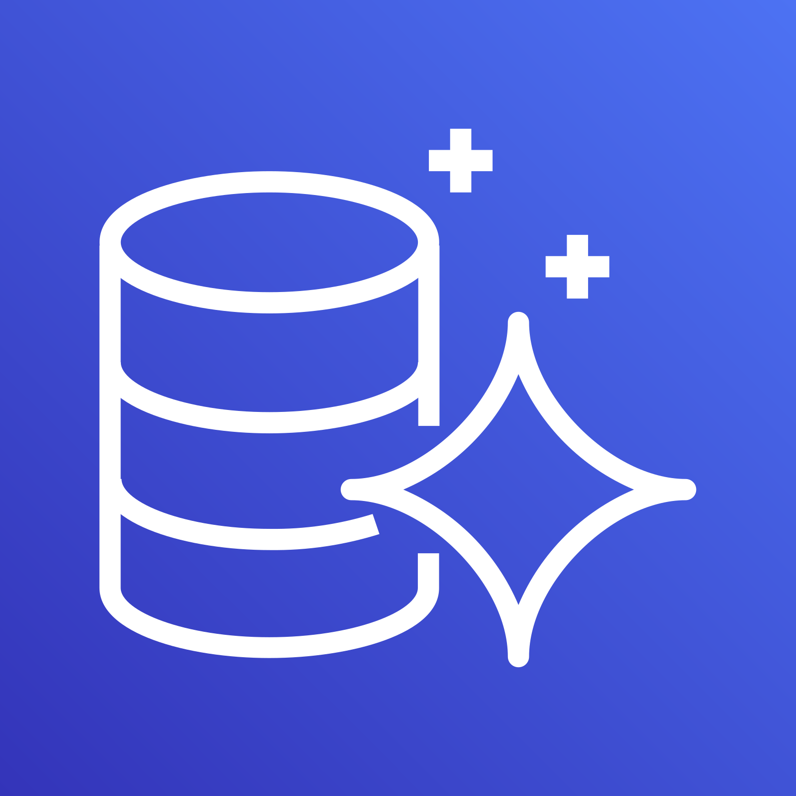

# Amazon Aurora

Estado do material: **em revisao**. Origem: anotações anteriores migradas; conferência online das fontes pendente (rede bloqueada).

    

---

## O que é?

Amazon Aurora é um serviço de banco de dados relacional gerenciado pela AWS, projetado para oferecer alta performance, disponibilidade e compatibilidade com MySQL e PostgreSQL. Ele combina a velocidade e a disponibilidade de bancos de dados comerciais de alto nível com a simplicidade e o custo-benefício dos bancos de dados de código aberto.

Aurora reduz tarefas administrativas de banco de dados, como provisionamento de hardware, aplicação de patches, backups e recuperação. Isso permite que os usuários se concentrem no design e na otimização de suas aplicações, melhorando a eficiência e reduzindo os custos.

## Compatibilidade

Amazon Aurora suporta os seguintes motores de banco de dados:

- MySQL
- PostgreSQL

## Alta Disponibilidade e Durabilidade

### Multi-AZ Deployments

Aurora armazena automaticamente seis cópias dos seus dados em três zonas de disponibilidade (AZs) da AWS e faz backup contínuo para o Amazon S3. Ele pode detectar falhas automaticamente e se recuperar delas rapidamente, proporcionando alta disponibilidade sem intervenção manual.

O armazenamento distribuído do cluster é diferente das instâncias de leitura. Planeje uma ou mais Aurora Replicas em AZs adequadas para a estratégia de disponibilidade. Replicação de armazenamento e replicação/leitura/failover de instâncias não devem ser confundidas com a cópia standby síncrona do modelo clássico RDS Multi-AZ.

## Amazon Aurora Serverless

Amazon Aurora Serverless é uma configuração on-demand para Amazon Aurora, que ajusta capacidade conforme a demanda e configuração. As versões Serverless têm comportamentos diferentes; escala a zero/pausa depende da versão de engine, região e capacidade mínima suportada. Isso é ideal para aplicações com cargas de trabalho intermitentes, imprevisíveis ou que variam significativamente.

### Benefícios do Aurora Serverless

- **Escalabilidade Automática**: Ajusta automaticamente a capacidade do banco de dados com base na demanda da aplicação.
- **Custo-Efetivo**: Pague apenas pela capacidade que você realmente utiliza, sem necessidade de provisionar recursos antecipadamente.
- **Simplicidade**: Elimina a necessidade de gerenciar a capacidade do banco de dados, permitindo que você se concentre no desenvolvimento da aplicação.

### Casos de Uso

- **Aplicações com Cargas de Trabalho Variáveis**: Ideal para aplicações que experimentam picos de tráfego imprevisíveis.
- **Ambientes de Desenvolvimento e Teste**: Perfeito para ambientes que não precisam estar em execução constante.
- **Aplicações Event-Driven**: Adequado para aplicações que são acionadas por eventos e não têm uma carga de trabalho constante.

## Pontos Chaves

- Amazon Aurora é um serviço de banco de dados relacional que oferece alta performance, disponibilidade e compatibilidade com MySQL e PostgreSQL.
- Como um serviço gerenciado, Aurora pode ser acessado pelo console, pela AWS CLI ou por chamadas de interface de programação de aplicativo (API).
- Aurora oferece recursos para redundância e backups automatizados.
- Comparações promocionais de performance dependem de benchmark e workload; valide consultas, dados e configuração antes de concluir ganho.
- Aurora permite escalar a capacidade de leitura e escrita de forma independente, com até 15 réplicas de leitura de baixa latência.
- Amazon Aurora Serverless oferece escalabilidade automática e é ideal para cargas de trabalho intermitentes, imprevisíveis ou variáveis, proporcionando uma solução custo-efetiva e simples de gerenciar.

## Fontes e cuidados

Backups, retenção, proteção contra exclusão, permissões, esquema e consultas exigem configuração do cliente. Dimensione escrita e leitura conforme o modo do cluster; réplicas de leitura não significam escrita independente em cada uma. Considere instâncias/ACUs, armazenamento, I/O, backup e transferência no custo.

- [Aurora](https://docs.aws.amazon.com/AmazonRDS/latest/AuroraUserGuide/CHAP_AuroraOverview.html)
- [Aurora Serverless v2](https://docs.aws.amazon.com/AmazonRDS/latest/AuroraUserGuide/aurora-serverless-v2.html)
- [Comparar RDS](rds.md)

[Voltar ao índice](README.md)
