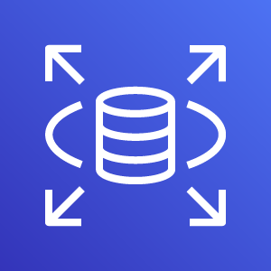

# Amazon Relational Database Service (RDS)

Estado do material: **em revisao**. Origem: anotações anteriores migradas; conferência online das fontes pendente (rede bloqueada).

    

---

## O que é?

O Amazon Relational Database Service (Amazon RDS) é um serviço gerenciado da AWS que facilita a configuração, operação e escalonamento de bancos de dados relacionais na nuvem.

Ele oferece suporte a vários motores de banco de dados populares, como **MySQL**, **PostgreSQL**, **MariaDB**, **Oracle** e **Microsoft SQL Server**, além do próprio **Aurora** da Amazon.

O RDS reduz tarefas administrativas de banco de dados, como provisionamento de hardware, patching de software, backup e recuperação. Ele permite que os usuários se concentrem no design e na otimização de suas aplicações ao invés de gerenciar a infraestrutura do banco de dados, melhorando a eficiência e reduzindo os custos.

---

## Compatibilidade

Amazon RDS suporta os seguintes motores de banco de dados:

- MySQL
- PostgreSQL
- MariaDB
- Oracle Database
- Microsoft SQL Server
- Amazon Aurora (uma implementação compatível com MySQL e PostgreSQL)

---

## Alta Disponibilidade e Durabilidade

### Multi-AZ Deployments

O RDS pode ser configurado para executar em múltiplas Zonas de Disponibilidade, proporcionando failover automático para a instância secundária sem intervenção manual no caso de falha.

Um dos principais recursos do Amazon RDS é configurar uma instância de banco de dados com alta disponibilidade usando uma implantação multi-AZ.

Essa configuração gera automaticamente uma cópia em espera da instância de banco de dados em outra zona de disponibilidade na mesma Virtual Private Cloud (VPC).

Após a cópia completa inicial, as transações são replicadas de forma síncrona para a cópia em espera. A execução de um banco de dados em várias zonas de disponibilidade pode aumentar a disponibilidade durante a manutenção planejada do sistema.

Isso ajuda a evitar falhas no seu banco de dados e interrupções nas zonas de disponibilidade.

---

## Alta disponibilidade não substitui recuperação de dados

A escolha correta depende do problema: falha de infraestrutura, aumento de leitura ou erro lógico nos dados.

| Recurso RDS | Problema principal | Comportamento relevante |
| --- | --- | --- |
| **Multi-AZ DB instance** | Falha da instância primária ou AZ | Standby em outra AZ e failover automático; **standby não atende leituras** |
| **Read replica** | Escalar consultas de leitura; outros usos dependem da engine | Réplica geralmente assíncrona; não é automaticamente o standby da implantação Multi-AZ clássica |
| **Automated backups + logs** | Recuperação dentro da janela de retenção | Permitem **Point-in-Time Recovery (PITR)** quando a modalidade/engine suporta |
| **Manual DB snapshot** | Preservar estado de um instante | Captura um ponto de restauração; por si só não fornece failover contínuo |

**Multi-AZ DB clusters** têm arquitetura distinta da instância Multi-AZ clássica: incluem instâncias leitoras e não devem ser confundidos com o standby exclusivo da implantação clássica. Verifique engine e modalidade.

### RPO e RTO na prática

- **RPO (Recovery Point Objective):** quantidade máxima de perda de dados tolerável, medida em tempo.
- **RTO (Recovery Time Objective):** tempo máximo tolerável para restabelecer o serviço.
- **PITR:** recupera o banco em um momento suportado dentro da retenção de backups, criando **nova instância**; não é um comando para desfazer em tempo real uma alteração no banco original.
- **Failover Multi-AZ:** visa restaurar a operação após falhas de infraestrutura, não desfazer um `DELETE` incorreto propagado pelo banco.
- **Backups:** a recuperação depende da retenção, do último ponto restaurável, de permissões, da capacidade e da validação prática do processo.

**Cenários para reconhecer:** uma AZ indisponível sugere avaliar Multi-AZ; uma exclusão acidental sugere PITR/backups; uma aplicação com muitas leituras pode se beneficiar de read replicas. Combinar recursos pode ser necessário, mas não significa que todos cumpram a mesma função.

- [RDS — Multi-AZ](https://docs.aws.amazon.com/AmazonRDS/latest/UserGuide/Concepts.MultiAZ.html)
- [RDS — Read replicas](https://docs.aws.amazon.com/AmazonRDS/latest/UserGuide/USER_ReadRepl.html)
- [RDS — Backups e Point-in-Time Recovery](https://docs.aws.amazon.com/AmazonRDS/latest/UserGuide/USER_WorkingWithAutomatedBackups.html)

## Amazon RDS Proxy

O **Amazon RDS Proxy** é um **proxy de banco de dados totalmente gerenciado** que atua como intermediário entre as aplicações e a instância do RDS.

### Principais Benefícios

- **Alta disponibilidade**: mantém conexões abertas e as redireciona automaticamente durante failovers de Multi-AZ, reduzindo significativamente o tempo de interrupção percebido pelas aplicações.
- **Gerenciamento de conexões**: pooling eficiente, reduzindo overhead de abrir/fechar conexões de forma frequente (muito útil em apps serverless como **AWS Lambda**).
- **Segurança**: integra-se com **AWS Secrets Manager** e **IAM Authentication**, eliminando a necessidade de armazenar credenciais fixas em código.
- **Escalabilidade**: absorve picos de tráfego sem sobrecarregar diretamente o banco.

### Casos de Uso

- Aplicações críticas que sofrem **timeouts durante failover** de Multi-AZ.
- Aplicações serverless (ex.: **Lambda**) que abrem milhares de conexões simultâneas.
- Ambientes que exigem **rotação de credenciais segura e automática**.

---

## Pontos Chaves

- O Amazon RDS é um serviço de banco de dados que facilita a configuração, a operação e o dimensionamento de um banco de dados relacional na nuvem.
- Como um serviço gerenciado, o Amazon RDS pode ser acessado pelo console, pela AWS CLI ou por chamadas de interface de programação de aplicativo (API).
- O Amazon RDS oferece recursos para redundância e backups automatizados.
- O Amazon RDS é compatível com uma variedade de mecanismos de banco de dados, como Amazon Aurora, PostgreSQL, MySQL, MariaDB, Oracle Database e Microsoft SQL Server.
- O **Amazon RDS Proxy** é recomendado em cenários de **alta disponibilidade, failover rápido, uso intensivo de conexões e segurança avançada com IAM/Secrets Manager**.

## Escolha e limites

O texto de standby síncrono descreve a implantação clássica **Multi-AZ DB instance**. Ela não usa o standby para escalar leitura; existem também **Multi-AZ DB clusters** com topologia e capacidades distintas. Read replicas atendem outros requisitos e possuem semântica própria. Compare o modo e a engine antes de projetar.

RDS Proxy gerencia conexões e pode reduzir impacto de failover, mas não elimina a necessidade de retentativas nem aumenta a capacidade de processamento do banco sem limite. Secrets Manager, IAM Authentication e engines têm compatibilidades e configuração próprias.

O catálogo também citava Db2; confira engines, versões, licenças, regiões e ciclo de suporte. Cliente continua responsável por schema, consultas, credenciais e escolha de backups/retenção. Custo inclui instância, armazenamento/I/O, backups, proxy e transferência.

- [RDS](https://docs.aws.amazon.com/AmazonRDS/latest/UserGuide/Welcome.html)
- [Multi-AZ](https://docs.aws.amazon.com/AmazonRDS/latest/UserGuide/Concepts.MultiAZ.html)
- [RDS Proxy](https://docs.aws.amazon.com/AmazonRDS/latest/UserGuide/rds-proxy.html)
- [Comparar Aurora](aurora.md)

[Voltar ao índice](README.md)
