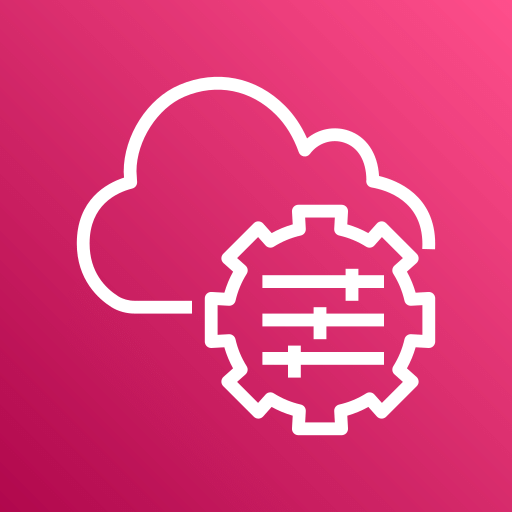

# AWS Systems Manager

Estado do material: **em revisao**. Origem: anotações anteriores e reconstrução editorial.
Revisão técnica nas fontes: pendente; acesso oficial bloqueado em 2026-10-30.

## Problema resolvido

Systems Manager administra nós e automatiza tarefas operacionais em ambientes suportados, incluindo instâncias EC2 e máquinas híbridas registradas. Ajuda a obter inventário, gerenciar configuração, executar ações e aplicar patches. Não é um orquestrador de containers; essa explicação está em [ECS](../computacao/ecs.md).

## Capacidades

| Capacidade | Finalidade | Cuidado |
| --- | --- | --- |
| Session Manager | Sessão interativa, comandos e caminhos de túnel suportados | Registro do nó, IAM, agente e conectividade; política de sessões |
| Run Command | Executar comandos remotamente em nós selecionados | Conferir seleção por IDs/tags, escopo e saída |
| Automation | Runbooks com passos operacionais e integrações | Função de execução, aprovações e impacto de cada passo |
| Patch Manager | Políticas e execução de aplicação de patches | Baselines, janelas, reboot e validação; não garante ausência de vulnerabilidades |
| Inventory | Coletar inventário de software e configuração suportados | Configure associação/coleta e período |
| State Manager | Manter estado desejado por associações | Revisar frequência, documentos e efeitos recorrentes |
| Parameter Store | Configurações e valores, incluindo SecureString via KMS | Permissões por caminho, versões, tiers e custos; não substitui automaticamente rotação de segredos |

Use Secrets Manager quando requisitos como rotação e ciclo de vida de segredos justificarem a alternativa. Run Command executa uma ação; State Manager reaplica uma associação conforme configuração; Automation coordena passos de um procedimento.

## Pré-requisitos de um nó gerenciado

1. SO e tipo de máquina suportados; SSM Agent instalado, atualizado e em execução quando a capacidade o exigir.
2. Registro na conta e região corretas: perfil/função de instância ou mecanismo de registro híbrido adequado, conforme o modo de gestão escolhido.
3. Permissões do nó para se comunicar com o serviço e permissões distintas para a pessoa/automação iniciar a ação. Acesso ao nó não equivale à autorização para ler parâmetros/KMS.
4. Conectividade HTTPS de saída para endpoints Systems Manager/ssmmessages e outros exigidos pela região, versão do agente e funcionalidade. Pode usar saída autorizada ou endpoints VPC com DNS, security groups e políticas corretos.
5. Para logs, artefatos, patches e KMS, conferir também os serviços e destinos adicionais necessários. Um endpoint isolado não assegura acesso a todos os recursos.

Os endpoints exatos variam; não abra rede indiscriminadamente. Confira a documentação da região e do agente antes de configurar.

## Session Manager e SSH

| Aspecto | Session Manager | SSH tradicional |
| --- | --- | --- |
| Autorização | IAM e política de sessão, nó registrado | Conta do SO e chave/mecanismo SSH |
| Rede | Agente inicia comunicação com serviços; não precisa abrir porta 22 de entrada para sessão nativa | Caminho de rede até sshd (público ou privado), porta e regras adequadas |
| Credenciais | Sessão autorizada; controlar privilégio no SO | Proteger chave privada e usuário da AMI |
| Auditoria | CloudTrail para APIs; logs de sessão suportados precisam ser configurados | Logs do SO/sshd e controles complementares |

Não há gravação de conteúdo de sessão para todos os modos: port forwarding e SSH sobre Session Manager têm limitações de logging. Avalie exigência de registro antes de escolher. Para SSH direto, use o [roteiro completo](../../laboratorios/ec2-ssh/README.md).

## Diagnóstico: nó indisponível

1. Confira conta, região, ID e estado da máquina; veja se aparece como nó gerenciado.
2. Verifique instalação, serviço e logs locais do SSM Agent por um caminho já autorizado.
3. Confira perfil/função, credenciais válidas e permissões necessárias ao nó; verifique também negações e limites de organização.
4. Teste DNS e conexão HTTPS aos endpoints exigidos, rotas, proxy, firewall do SO, security groups e NACLs. Em endpoints privados, confira DNS privado e regras da interface.
5. Se o nó está online mas a ação falha, verifique permissões da pessoa, documento permitido, parâmetros, região e recursos associados (S3/KMS/CloudWatch).
6. Registre evidência e valide a correção sem ampliar privilégios além do necessário.

O diagnóstico é um exercício de leitura; não foi executado em conta AWS.

## Segurança, auditoria e custos

Restrinja documentos, destinos e ações IAM; comandos remotos podem executar com privilégio elevado. Não grave senhas em comandos, histórico ou logs. Use SecureString/KMS e políticas por caminho para parâmetros sensíveis; evite imprimir valores.

Registre chamadas no CloudTrail e configure retenção e proteção dos logs em S3/CloudWatch quando suportado. Revise criptografia e acesso aos registros. Automatizações e aplicação de patches exigem janelas, teste e recuperação, não apenas agendamento.

Cobrança varia por capacidade, nós gerenciados e tiers. Automation, parâmetros avançados, maior throughput, gestão híbrida avançada e recursos associados podem gerar custos. Inclua endpoints de interface, KMS, logs, S3 e transferência na estimativa. Consulte a tabela vigente; não assuma que todo Systems Manager é gratuito.

## Perguntas e respostas

1. Abrir SSH faz um nó aparecer no Systems Manager? Não: agente, registro, permissões e conectividade de serviço são requisitos próprios.
2. Ter permissão para StartSession permite qualquer comando em qualquer nó? Não: escopo IAM, documento, condições e privilégio do SO precisam ser controlados.
3. Parameter Store é apenas um arquivo de senhas? Não: guarda configuração/versionamento e pode proteger valores com KMS; gestão e rotação dependem do desenho.
4. Run Command e Automation são iguais? Não: o primeiro executa comandos em nós; o segundo orquestra procedimentos de múltiplos passos e APIs.

## Fontes oficiais a conferir

- [O que é Systems Manager](https://docs.aws.amazon.com/systems-manager/latest/userguide/what-is-systems-manager.html)
- [SSM Agent](https://docs.aws.amazon.com/systems-manager/latest/userguide/ssm-agent.html)
- [Session Manager](https://docs.aws.amazon.com/systems-manager/latest/userguide/session-manager.html)
- [Endpoints VPC](https://docs.aws.amazon.com/systems-manager/latest/userguide/setup-create-vpc.html)
- [Parameter Store](https://docs.aws.amazon.com/systems-manager/latest/userguide/systems-manager-parameter-store.html)
- [Preços](https://aws.amazon.com/systems-manager/pricing/)

[Voltar ao índice](README.md)
