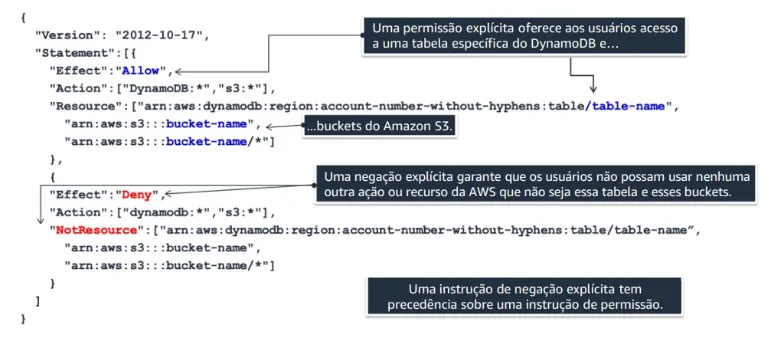

# AWS Identity and Access Management (IAM)

Estado do material: **em revisao**. Origem: anotações anteriores e reconstrução editorial.
Revisão técnica nas fontes: pendente; acesso oficial bloqueado em 2026-10-30.


## Problema resolvido e identidades

IAM controla autenticação e autorização de acesso às APIs e recursos AWS. **Usuário** pode ter senha e access keys de longa duração; **grupo** reúne usuários com necessidades semelhantes; **função (role)** é assumida por uma identidade ou serviço autorizado e usa credenciais temporárias, normalmente emitidas via AWS STS.

Para pessoas, prefira federação e [IAM Identity Center](identity-center.md). Para aplicações em EC2, use função por instance profile, sem embutir chaves permanentes. Grupos facilitam anexar permissões comuns, mas não são identidades que assumem funções. Root é uma identidade privilegiada da conta, não uma categoria de conta pessoal; veja [responsabilidade compartilhada](../../fundamentos/responsabilidade-compartilhada.md).

## Políticas: confiança e permissões

| Tipo | Onde fica | Pergunta respondida |
| --- | --- | --- |
| Baseada em identidade | Usuário, grupo ou função | Quais ações a identidade pode realizar sobre quais recursos? |
| Baseada em recurso | Recurso que oferece esse mecanismo, como bucket S3 ou fila SQS | Quais principals podem usar este recurso, sob quais condições? |
| Confiança de uma função | A própria função IAM, política baseada em recurso | Quem pode assumir a função e em quais condições? |
| Permissões de uma função | Políticas anexadas/embutidas na função | O que a sessão da função pode fazer após assumi-la? |

Políticas gerenciadas são reutilizáveis, mantidas pela AWS ou pelo cliente. Políticas inline pertencem a uma identidade específica. ARNs de S3 ou DynamoDB em um documento não bastam para classificá-lo: observe onde está anexado, o elemento `Principal` quando aplicável e o tipo da política.



A imagem é preservada como material de apoio; a classificação não é inferida apenas dos ARNs representados nela. `Deny` explícito prevalece sobre permissões aplicáveis; `NotResource` exige cuidado, pois combina ações, escopo e avaliação e não deve ser copiado sem análise.

### Confiança ilustrativa para EC2

```json
{
  "Version": "2012-10-17",
  "Statement": [{
    "Effect": "Allow",
    "Principal": {"Service": "ec2.amazonaws.com"},
    "Action": "sts:AssumeRole"
  }]
}
```

O serviço autorizado a assumir a função não recebe, só com isso, acesso a objetos S3.

### Permissão ilustrativa de leitura

```json
{
  "Version": "2012-10-17",
  "Statement": [
    {"Effect": "Allow", "Action": "s3:GetObject", "Resource": "arn:aws:s3:::meu-bucket-exemplo/dados/*"},
    {"Effect": "Allow", "Action": "s3:ListBucket", "Resource": "arn:aws:s3:::meu-bucket-exemplo", "Condition": {"StringLike": {"s3:prefix": ["dados/*"]}}}
  ]
}
```

Nomes e ARNs são ilustrativos. `GetObject`, `PutObject` e `DeleteObject` operam em objetos; `ListBucket` usa o ARN do bucket e só é necessário se a aplicação listar objetos. Para SSE-KMS, pode ser necessário `kms:Decrypt` e autorização da chave. Políticas do bucket, endpoints e outros controles também entram na avaliação.

## Limites, STS e SCPs

STS emite credenciais temporárias com expiração para sessões, como AssumeRole entre contas. Em terceiros, condições como External ID ajudam a tratar o problema de *confused deputy*; não substituem a autorização completa.

SCPs no AWS Organizations definem o limite máximo de permissões disponível às identidades das contas-membro afetadas. **Não concedem acesso.** É preciso uma permissão aplicável e ausência de negação. A hierarquia de organização/OUs/conta importa. SCPs não restringem identidades da conta de gerenciamento nem funções vinculadas a serviços (*service-linked roles*); o root de uma conta-membro está sujeito às SCPs aplicáveis.

Permissions boundaries e session policies também podem limitar sessões; não são permissões adicionais por si sós. A avaliação entre contas e de políticas baseadas em recurso possui particularidades documentadas.

## MFA, diretórios e auditoria

- MFA acrescenta fatores à autenticação; proteja root e acessos humanos privilegiados. Não elimina todo risco de phishing.
- Políticas de senha de usuários IAM controlam comprimento, complexidade e reutilização, conforme a estratégia de identidade. Não substituem federação/MFA.
- IAM Identity Center (nome atual de AWS SSO) centraliza acesso da força de trabalho. AD Connector atua como gateway para um Active Directory existente nos cenários suportados; não sincroniza pessoas para criar usuários IAM.
- IAM Access Analyzer ajuda a validar políticas e identificar acesso externo/público em recursos suportados; Access Advisor e dados de último acesso ajudam a investigar permissões não utilizadas.
- CloudTrail fornece eventos para auditoria de chamadas suportadas. Configure coleta, retenção, alertas e proteção dos logs.

## Segurança, custos e exercício

Aplique menor privilégio, separe funções de administração e aplicação e evite segredos em código. IAM não tem tarifa adicional de uso básico; recursos associados e funcionalidades de análise específicas podem gerar custos. Consulte preços antes de habilitá-los.

Resolva o [cenário EC2 lendo S3](../../laboratorios/cenarios-fundamentais/README.md#1-iam-aplicação-ec2-lendo-s3). Estudo relacionado: [perguntas IAM](../../certificacoes/perguntas-fundamentais.md#iam).

## Perguntas e respostas

1. Confiança autoriza ler S3? Não: permite assumir a função; a sessão precisa de permissões para os objetos.
2. Uma SCP Allow libera uma API? Não: remove uma restrição daquele limite, mas não concede a permissão IAM.
3. É necessário distribuir uma access key à EC2? Em geral não: o SDK obtém credenciais temporárias da função associada à instância.

## Fontes

- [Tipos de políticas](https://docs.aws.amazon.com/IAM/latest/UserGuide/access_policies.html)
- [Funções e confiança](https://docs.aws.amazon.com/IAM/latest/UserGuide/id_roles.html)
- [Avaliação de políticas](https://docs.aws.amazon.com/IAM/latest/UserGuide/reference_policies_evaluation-logic.html)
- [SCPs e exceções](https://docs.aws.amazon.com/organizations/latest/userguide/orgs_manage_policies_scps.html)
- [Boas práticas IAM](https://docs.aws.amazon.com/IAM/latest/UserGuide/best-practices.html)
- [AD Connector](https://docs.aws.amazon.com/directoryservice/latest/admin-guide/directory_ad_connector.html)
- [Preços IAM](https://aws.amazon.com/iam/pricing/)

[Voltar ao índice](README.md)
