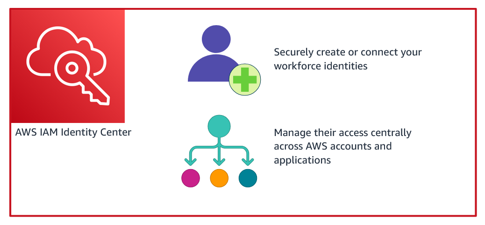

# AWS IAM Identity Center

Estado do material: **em revisao**. Origem: anotações anteriores e reconstrução editorial.
Revisão técnica nas fontes: pendente; acesso oficial bloqueado em 2026-10-30.

## Acesso da força de trabalho

IAM Identity Center centraliza acesso de pessoas a múltiplas contas AWS e aplicações empresariais suportadas. Seu nome anterior era AWS Single Sign-On (AWS SSO). Não é um painel para administrar access keys de usuários IAM.

## Como os elementos se relacionam

1. **Fonte de identidade:** diretório do Identity Center, diretório Microsoft AD suportado ou provedor externo, conforme integração. Autenticação e provisionamento/sincronização de identidades são aspectos distintos.
2. **Usuários e grupos:** representam a força de trabalho e seus agrupamentos. O provisionamento depende da fonte; não implica criar usuários IAM em cada conta.
3. **Permission sets:** conjuntos de políticas e configurações de sessão que descrevem um nível de acesso a contas AWS.
4. **Atribuições:** relacionam usuário/grupo, conta e permission set; aplicações possuem suas atribuições e configuração próprias.
5. **Portal de acesso AWS:** a pessoa autentica e escolhe conta/função ou aplicação autorizada; fluxos de CLI também permitem obter sessões temporárias.
6. **Funções IAM nas contas:** permission sets provisionados resultam em funções IAM apropriadas nas contas de destino. Sessões dessas funções são temporárias e continuam sujeitas a controles como SCPs.

Gerenciamento de access keys, política de senha de usuário IAM e análise de último acesso de IAM pertencem a outros mecanismos. Consulte [IAM](iam.md). AD Connector não cria usuários IAM a partir de AD; a integração precisa seguir o modo suportado.

## Segurança, custos e estudo

Prefira grupos por responsabilidade, permission sets de menor privilégio, MFA na fonte apropriada e revisão periódica de atribuições. Audite eventos e encerramento de acesso quando alguém muda de função. Não use root no trabalho diário; ele não é “conta pessoal”.

Identity Center não tem cobrança adicional pelo serviço básico; diretórios e aplicações associadas podem ter custos. Confira elegibilidade por tipo de instância, regiões, integração e preços nas fontes antes de implantar.

## Perguntas e respostas

1. Permission set é usuário IAM? Não: define acesso que é provisionado como funções nas contas atribuídas.
2. Mudar de conta exige distribuir uma access key permanente? Não no fluxo federado usual: a pessoa obtém sessão temporária conforme suas atribuições.
3. Qual a prática proposta? Desenhar dois grupos (leitura e operação), permission sets mínimos e atribuições por conta, sem criar recursos.

## Fontes

- [O que é IAM Identity Center](https://docs.aws.amazon.com/singlesignon/latest/userguide/what-is.html)
- [Permission sets](https://docs.aws.amazon.com/singlesignon/latest/userguide/permissionsetsconcept.html)
- [Fontes de identidade](https://docs.aws.amazon.com/singlesignon/latest/userguide/manage-your-identity-source.html)

[Voltar ao índice](README.md)
